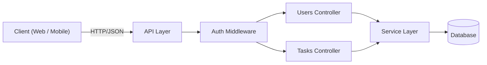
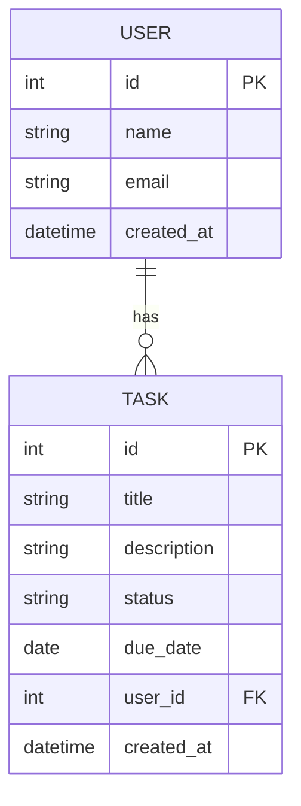

# Task Management API – Contract

قرارداد اولیهٔ API برای مدیریت کاربران (Users) و وظایف (Tasks).

- مشخصات کامل: [`openapi.yaml`](./openapi.yaml)
- فرمت: JSON | احراز هویت: `Authorization: Bearer <token>`

## Resources
- **User**: `id`, `name`, `email`, `created_at`
- **Task**: `id`, `title`, `description`, `status` (`todo` | `in_progress` | `done`), `due_date`, `user_id`, `created_at`

رابطه: هر User می‌تواند چند Task داشته باشد (۱ به N).

## Endpoints

### Users
| Method | Endpoint | موفق | خطا |
|---|---|---|---|
| GET | `/api/users` | 200 | 401, 500 |
| GET | `/api/users/{id}` | 200 | 401, 404 |
| POST | `/api/users` | 201 | 400, 409, 422 |
| PUT | `/api/users/{id}` | 200 | 400, 404, 422 |
| PATCH | `/api/users/{id}` | 200 | 400, 404, 422 |
| DELETE | `/api/users/{id}` | 204 | 401, 404 |
| GET | `/api/users/{id}/tasks` | 200 | 401, 404 |

### Tasks
| Method | Endpoint | موفق | خطا |
|---|---|---|---|
| GET | `/api/tasks?status=&user_id=&page=&limit=` | 200 | 400, 401 |
| GET | `/api/tasks/{id}` | 200 | 401, 404 |
| POST | `/api/tasks` | 201 | 400, 401, 422 |
| PUT | `/api/tasks/{id}` | 200 | 400, 404, 422 |
| PATCH | `/api/tasks/{id}` | 200 | 400, 404, 422 |
| DELETE | `/api/tasks/{id}` | 204 | 401, 404 |

## قالب خطا
```json
{ "error": "NOT_FOUND", "message": "Task with id 99 not found" }
```

## معماری


## مدل داده
