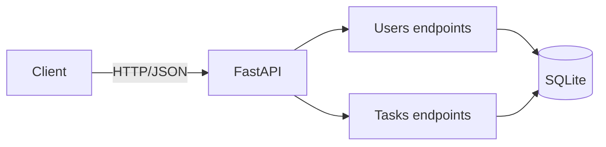

# Task Management API – Dockerized Backend

این مخزن شامل پیاده‌سازی اولیه API مدیریت کاربران (Users) و وظایف (Tasks) با **Python + FastAPI + SQLite** و فایل‌های لازم برای اجرای آن در Docker است.

- قرارداد API: [openapi.yaml](./openapi.yaml)
- مستندات تعاملی پس از اجرا: http://localhost:8000/docs

## اجرای پروژه بدون Docker

```bash
pip install -r requirements.txt
uvicorn main:app --reload
```

## اجرای پروژه با Docker

### 1. ساخت Image

از پوشه اصلی پروژه اجرا کنید:

```bash
docker build -t student-management-api:1.0 .
```

### 2. اجرای Container با Port Mapping

```bash
docker run -d --name student-management-api -p 8000:8000 -v student-management-data:/app/data student-management-api:1.0
```

در این دستور پورت 8000 سیستم میزبان به پورت 8000 کانتینر متصل می‌شود. Volume با نام `student-management-data` باعث می‌شود اطلاعات SQLite بعد از حذف و ساخت مجدد کانتینر باقی بماند.

### 3. بررسی وضعیت Container

```bash
docker ps
docker logs student-management-api
```

### 4. تست API

- صفحه اصلی: http://localhost:8000/
- سلامت سرویس: http://localhost:8000/health
- Swagger UI: http://localhost:8000/docs

نمونه ساخت کاربر:

```bash
curl -X POST http://localhost:8000/api/users \
  -H "Content-Type: application/json" \
  -d '{"name":"Ali","email":"ali@example.com"}'
```

نمونه ساخت وظیفه (شناسه کاربر را از پاسخ مرحله قبل بردارید):

```bash
curl -X POST http://localhost:8000/api/tasks \
  -H "Content-Type: application/json" \
  -d '{"title":"First task","description":"Docker test","user_id":1,"status":"todo"}'
```

### 5. توقف و حذف Container

```bash
docker stop student-management-api
docker rm student-management-api
```

برای حذف داده‌های ذخیره‌شده نیز (اختیاری):

```bash
docker volume rm student-management-data
```

## فایل‌های Docker

- `Dockerfile`: ساخت image بر پایه Python 3.12 slim و اجرای FastAPI با Uvicorn.
- `.dockerignore`: جلوگیری از ارسال فایل‌های غیرضروری و داده‌های محلی به build context.
- `requirements.txt`: وابستگی‌های برنامه.

## API Resources

- **User**: `id`, `name`, `email`, `created_at`
- **Task**: `id`, `title`, `description`, `status` (`todo` | `in_progress` | `done`), `due_date`, `user_id`, `created_at`

رابطه: هر User می‌تواند چند Task داشته باشد (۱ به N).

## Endpoints

### Users

| Method | Endpoint |
|---|---|
| GET | `/api/users` |
| POST | `/api/users` |
| GET | `/api/users/{id}` |
| PUT / PATCH / DELETE | `/api/users/{id}` |
| GET | `/api/users/{id}/tasks` |

### Tasks

| Method | Endpoint |
|---|---|
| GET / POST | `/api/tasks` |
| GET | `/api/tasks/{id}` |
| PUT / PATCH / DELETE | `/api/tasks/{id}` |

## خطاها

خطاهای API در قالب JSON شامل `error` و `message` برگردانده می‌شوند. اعتبارسنجی ورودی‌ها نیز توسط FastAPI/Pydantic انجام می‌شود.

## معماری


